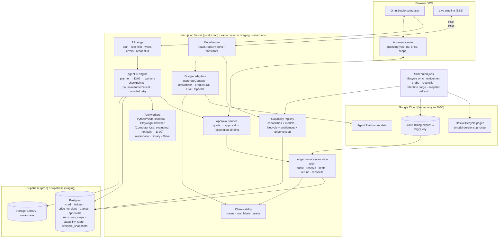

# 02 — Target architecture

Direction: **keep the shape** (Next.js 14 on Vercel, Supabase, Vertex-only Google, Vercel Sandbox, Cloud Run relay) and
add five things that the audit showed are missing. No framework upgrade, no new cloud, no new vendor.

1. **Capability registry** fed by a dated Google lifecycle table and our own probes — a capability turns itself off
   (or steps to its replacement) when its model's source lapses (`04`).
2. **One ledger with versioned prices** — quote binds a price version; reservation sized to the worst case, including
   cost that Google bills on timeout; settlement from usage; daily reconciliation against Cloud Billing export (`08`).
3. **Agent G engine** — a persisted DAG with parallel steps, checkpoints, pause/resume/cancel, bounded recovery, and a
   **server-side approval center** that binds every spend or external action to one recorded yes (`06`).
4. **Staging** — its own Supabase project, Vercel custom environment and Google project (or labelled budget), so
   paid certification never writes the production wallet (`09` M-6).
5. **Explicit data retention** — every Interactions call states `store`; deletion jobs follow our policy, not only
   Google's 7-day TTL (`07`, D-04 keeps `store=true` for now).

## Key properties

| Property | Today | Target |
|---|---|---|
| Model ids | constants + env | registry rows with lifecycle and entitlement; constants only as seed |
| Retirement handling | a person notices | daily job; alarm at T-45 days, auto step-down at T-7 days to the registry's replacement, owner told |
| Ledger | two | one (`credit_ledger`); legacy retired after B-02 data |
| Prices | code tables, promo rates | `price_versions` table, effective dates, quote binds a version |
| Failed call | refund in full | refund minus any cost Google bills on failure (long decode, timeouts) |
| Agent G steps | one at a time | DAG, up to N parallel workers per run, each step checkpointed |
| Approval | per card, in the job row | approval center: one row per yes, bound to quote + reservation + scope + expiry |
| Staging | none (Previews share prod DB) | separate DB + env + Google budget |
| Interactions storage | Google default | `store` stated per feature in the registry; purge after policy window |
| Computer Use | not used | evaluated (`12`); build only with founder approval |
| Gemini Decision | not reachable (Developer API only) | stays off (D-05) |
| Carbon / Argon | not used | allowed only after Phase 5 billing rules (D-06) |

## What stays as it is

Next.js 14.2 / React 18 / Tailwind 3 / TypeScript strict / Node 24; the Supabase RPC style (`SECURITY DEFINER` with
`service_role`); the canonical credit functions and their idempotent `ref`; BOG callback verification and
`bog_fulfill_order`; Cloud Run relay; Vercel Sandbox for code and browser; WIF (no stored Google key).
