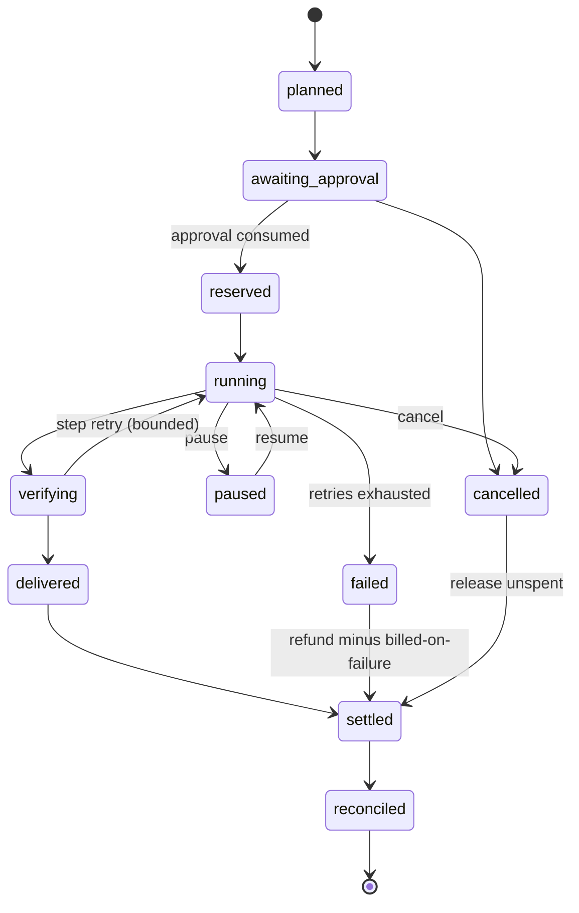

# 06 — Execution lifecycle

```
REQUEST → UNDERSTAND → PLAN → VALIDATE → QUOTE → APPROVE → RESERVE → EXECUTE → VERIFY → DELIVER → SETTLE → RECONCILE
```
The spec PDF is clipped after `EXECUTE → V…`; the tail `VERIFY → DELIVER → SETTLE → RECONCILE` is our proposal.

## 1. Stages

| Stage | Who | Output | Fails how | Today |
|---|---|---|---|---|
| REQUEST | API edge | request id, user, locale | 401 / rate limit | PROVEN |
| UNDERSTAND | intent (Gemini 3.8 Flash) | capability candidates, language | asks back | PROVEN (chat), IMPLEMENTED (Agent G) |
| PLAN | planner | DAG: steps, tools, inputs, per-step estimate | plan refused → explain | IMPLEMENTED (sequential) |
| VALIDATE | registry + policy | each step's capability available, entitled, in audience; inputs within limits; external domains allowed | `capability_unavailable` / `policy_denied` before any spend | **MISSING** (entitlement/lifecycle not checked) |
| QUOTE | ledger | credits, maxCredits, price version, expiry | — | PROVEN (media, code, Live) |
| APPROVE | approval center | approval id bound to quote | no yes → nothing runs | PROVEN per card; center MISSING |
| RESERVE | ledger | reservation = maxCredits | `budget_exhausted` | PROVEN |
| EXECUTE | engine + workers | step results, checkpoints, timeline events | bounded retry, then step failed | PARTIAL (no parallel) |
| VERIFY | engine | output checks (file exists, duration, language, vision QC where defined) | step failed → recovery or refund | PARTIAL (video QC) |
| DELIVER | Library | artifacts + report | — | PROVEN (PDF, media) |
| SETTLE | ledger | debit actual (≤ reserved), release rest; keep billed-on-failure part | — | PARTIAL (debit = quote) |
| RECONCILE | daily job | our booked cost vs Cloud Billing export per label | alarm on drift > 10 % | **MISSING** |

## 2. Run state machine



## 3. DAG and parallelism

- Steps declare `dependsOn`; independent steps run in parallel up to **3 workers per run** and **1 sandbox per user**
  at a time (Vercel Sandbox cost and the $20 cap).
- Each step is checkpointed (`run_steps.state`, inputs hash, outputs pointer) so resume and retry never redo paid work.
- Bounded recovery: at most 1 retry per step on a retryable error, at most 2 replans per run, and a run deadline
  (default 10 min, as autoTask today). After that: `failed`, settle, honest report.
- Long Google calls (Omni, Veo, background Interactions) are LRO steps polled by the engine, not held in a function.

## 4. Timeline events (SSE)

`run.planned · step.queued · step.started · step.progress · step.checkpoint · step.needs_approval · step.done ·
step.failed · run.paused · run.resumed · run.cost · run.delivered · run.settled` — each `{ runId, stepId?, at, data }`,
no personal data beyond what the user sees. The existing spinner/✓/fold card (#272, #275) renders these.

## 5. Where Gemini models fit (D-05, D-06)

UNDERSTAND and PLAN: `gemini-3.8-flash` (thinking `low`) with the registry's step-downs. Deep tasks on Carbon/Argon:
**not until Phase 5** ships versioned prices and the timeout-cost rule. Gemini Decision: not used (Developer API only).
