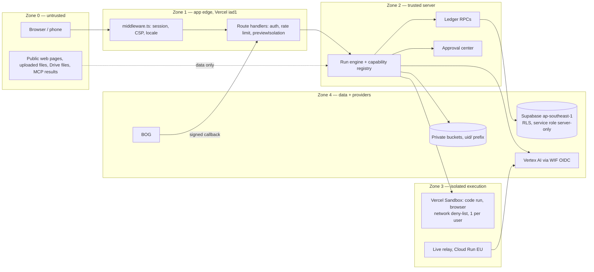

# 07 — Security boundaries

Target design. Status words describe **today** (from `docs/audit/07`); "Target" is a proposal for a later approved phase.

## 1. Trust zones

Rule for every arrow out of Zone 0: content is **data, never instructions**. A page, file, transcript or tool result
cannot start a tool, change a price, or approve anything.

## 2. Boundaries and controls

| # | Boundary | Control today | Status | Target |
|---|---|---|---|---|
| S-1 | User → API | Supabase session, route-handler client, `apiGuard`, Redis rate limits | IMPLEMENTED_UNVERIFIED | cross-user access matrix test in CI (one user cannot read/act on another's runs, artifacts, approvals) |
| S-2 | Admin surfaces | flags `=admin` (sandbox, Drive, BOG checkout) | IMPLEMENTED_UNVERIFIED | `Entitlement.audience` in the registry (`04`) is the only gate; D-08 keeps code run + browser `admin` until E2E |
| S-3 | Preview ↔ production | Previews share prod DB + wallet; paid writes blocked by `previewIsolation` | RISK | M-6 staging Supabase project (own DB, own wallet) — `09` |
| S-4 | Server → Vertex | WIF OIDC, no service-account key; Vertex-only (D-05) | PROVEN_PRODUCTION | registry refuses any model binding whose `surface` ≠ `vertex` |
| S-5 | Engine → sandbox | Vercel Sandbox, network deny private + metadata (IPv4), $20 lifetime cap, 1 per user | IMPLEMENTED_UNVERIFIED | add per-run egress allow-list for browser tasks the user named; keep deny-list as floor |
| S-6 | Browser agent → public sites | deny-list (`lib/agent/browser/policy.ts`), site agent asks Allow/No before spend/delete/send | PARTIAL | sensitive-action classes (login, payment, send, delete, form submit with personal data) **always** require an approval record; Computer Use `require_confirmation` mapped to the same record (`12`) |
| S-7 | Prompt injection | hidden-instruction test for ReAct; page text = data | PARTIAL | tool-call firewall: a tool call is allowed only if it is in the approved plan step or is `effect=read`; anything else → new approval |
| S-8 | Connectors | tokens encrypted (`CONNECTOR_TOKEN_KEY`), no anon grant, Drive `drive.file` | PROVEN_PRODUCTION (grant) | per-connector scopes in registry; revoke button; token never sent to the model |
| S-9 | MCP | empty allowlist | safe by default | allowlist per server with `effect` per tool; same approval rules as built-in tools |
| S-10 | Storage | private buckets, `{uid}/` keys, signed links 7 days | IMPLEMENTED_UNVERIFIED | signer refuses foreign prefixes (exists for `workspaces`); extend to all buckets + test |
| S-11 | BOG callback | SHA256withRSA over raw body, optional IP allowlist, idempotent fulfil | IMPLEMENTED (never sandbox-certified, B-03) | BOG sandbox certification in Phase 5 |
| S-12 | Secrets | Vercel env, no secrets in repo, legacy vendor keys partly cleared | PARTIAL | owner removes remaining legacy names; CSP drops legacy hosts |
| S-13 | Google data retention | Interactions `store=true` → 7 days on Vertex (C4); D-04 keeps it | DECIDED | Library copy is the durable record; privacy page says "Google keeps call state up to 7 days" — wording for GG |
| S-14 | Abuse | none (`safety_identifier` = 0) | MISSING | send a hashed, stable per-user safety identifier where the Vertex API accepts one (to verify) |
| S-15 | AI disclosure | not systematic | UNKNOWN | label generated media in Library + download metadata (wording for GG) |

## 3. Approval classes

| Class | Examples | Needs |
|---|---|---|
| A0 read | search, read page, read Drive file the user picked | nothing |
| A1 versioned write | workspace file save | nothing (versioned, undo) |
| A2 paid | any ✦ spend | quote + approval bound to quote (`05` `/api/approvals`) |
| A3 outward / irreversible | send email, submit form, purchase, delete, post, login with user credentials | approval naming the exact target and content; never batched; voice „კი" allowed only when the card shows the target |
| A4 forbidden | entering payment card data, solving CAPTCHA for the user, bypassing paywalls, actions on government/banking sites | refused by policy |

## 4. Data classification (summary)

Public · User content (chats, uploads, media) · Personal (email, phone, voice, face/avatar photo) · Financial (ledger,
BOG orders) · Secrets (tokens, keys). Personal and Financial never leave Zone 2/4 except to the provider that needs them
(Vertex for the user's own media, BOG for payment). Logs carry ids, not content; existing redaction tests stay mandatory.

## 5. Open for the founder

- S-3 staging project cost (a second Supabase project) — decision in `09` M-6.
- S-13/S-15 privacy and disclosure wording.
- S-6 A4 list — confirm the forbidden classes.
