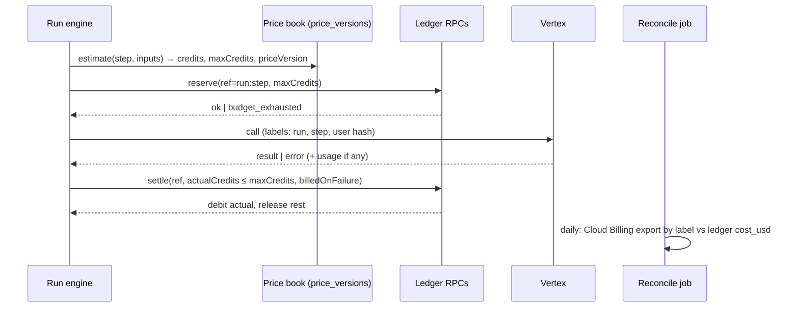

# 08 — Billing design

Target design for credits (✦) and GEL. No price, balance, RPC or migration changes in Phase 1. Today's facts:
`docs/audit/06`. **Legacy ledger (`public.credits`, `lib/billing/enforce.ts`) is not touched until GG's
`01_introspect.sql` result arrives (B-02).**

## 1. Principles

1. One ledger: `credit_ledger` → `profiles.credits_balance` (trigger). No second ledger, ever (spec §15).
2. Fail closed: no reservation → no provider call. Unknown price → capability unavailable, not free.
3. The user pays at most the approved quote (`maxCredits`). Our loss on a failed call is ours, not the user's.
4. Every debit and refund carries an idempotency `ref` we own (`metadata->>'ref'`), already unique-indexed.
5. Prices are versioned; a quote names the version it was priced with.
6. Claude never writes the production wallet. Top-ups are by GG (admin) or BOG.

## 2. Flow

## 3. Price book (new, proposal)

Table `price_versions(id, capability_id, model_id, unit, usd_per_unit, credits_per_unit, valid_from, valid_to,
source_url, fetched_at, approved_by)`. Rules:

- One active row per `(capability, model, unit)` at a time; changing a price = new row with `valid_from`.
- `source_url` = the official Google pricing page; `fetched_at` UTC. A row without a source is not usable.
- Promotional rows carry `valid_to` = promo end. Known: Argon promo ends **2026-11-30** ($2/$10 → $4/$20 per 1M);
  3.8/3.6 Flash and 3.8 TTS promos end **2026-12-31** (`docs/audit/06` §3). The registry alarm (`04` §5) fires T-7 days
  before any `valid_to` so credit prices are reviewed before margins flip.
- GG approves each new credits mapping (existing `pricingApproval.ts` path).

## 4. Worst-case reservation

`maxCredits` = price of the worst case the capability can produce, not the average:

| Capability | Worst case used |
|---|---|
| Text/agent step | max output tokens × output price + input tokens (counted, `countTokens` is free) + thinking budget cap |
| Gemini 4 Argon/Carbon (when D-06 lifts) | the full output cap **even on timeout** — Vertex bills >32K-token completions on timeout from 2026-11-13 |
| Video / Omni | longest duration × resolution tier in the quote |
| TTS | characters × price for the selected model (3.8 TTS tier) |
| Code run / browser | wall-clock cap × sandbox rate (inside the $20 lifetime cap) |
| Live | session cap (5 min non-admin) × per-minute price |

## 5. Settlement and billed-on-failure

`ProviderResult` (`05`) returns `usage` and `billedOnFailure: boolean`. Settlement rule:

| Outcome | User pays | We record |
|---|---|---|
| success | actual (≤ maxCredits) | cost_usd from usage |
| provider error, not billed (4xx before work, 5xx with no usage) | 0 (refund reservation) | 0 |
| provider error, **billed** (timeout after long decode, safety stop after output) | 0 by default | cost_usd as **loss** with reason, so it shows in reconcile |
| user cancel mid-run | completed steps only | partial cost |

Charging the user for a Google-side failure is a founder decision (default: no).

## 6. Reconciliation (MISSING today)

- Enable Cloud Billing export to BigQuery (owner action; no cost beyond storage).
- Every Vertex call carries labels `app=myavatar, cap=<capability>, run=<run id>` where the API accepts labels (to verify per API).
- Daily job: sum export cost by `cap` vs ledger `cost_usd` by `cap`; alarm when drift > 10 % or any unlabeled spend > $1/day.
- Output: `reconcile_reports` row + admin panel line. Read-only; never writes balances.

## 7. Legacy ledger retirement (after B-02 data only)

Plan, not to be started until GG's introspection result:
1. If `public.credits` is absent in prod → the 8 callers already fail; remove them behind a PR with tests.
2. If present with live rows → one-time migration of balances into `credit_ledger` with `ref=legacy:<user>`,
   then switch the 8 callers to `lib/orchestrator/ledger.ts`, then drop writes to `credits`.
3. Either way: `docs/ledger-unification/` runbook is the source; GG runs every production SQL.

## 8. BOG

Design stays as built (`docs/audit/06` §4). Phase 5: sandbox certification with BOG credentials GG supplies (B-03):
checkout → callback signature → fulfil once → replay → cron reconcile → refund path.
